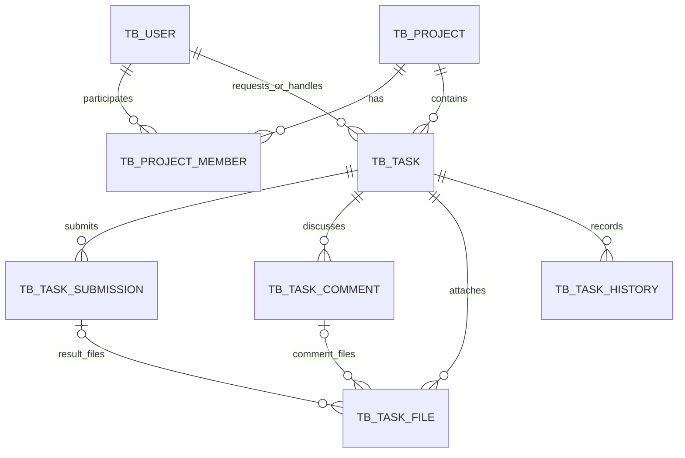

# 업무지원시스템 MVP 설계 v0.1

작성일: 2026-10-20  
단계: 구현 전 설계. 사용자 확정 사항과 구현을 위한 제안 규칙을 구분한다.  
기술 구성: React + TypeScript / Spring Boot + Spring Data JPA / MariaDB.  
이 문서는 기능 설계이며 라이브러리 버전·실행 코드·운영 배포 설정은 포함하지 않는다.

## 1. 범위와 결정 상태

### 사용자 확정 사항
- 직원 누구나 프로젝트를 생성하고, 생성자는 프로젝트 관리자가 된다.
- 업무는 프로젝트에 속하며 담당자는 한 명이다. 공동 작업은 담당자별로 업무를 나누어 등록한다.
- 담당자가 완료 요청하고 요청자가 승인해야 최종 완료된다.
- 같은 프로젝트 참여자는 모든 업무·댓글·첨부파일을 조회할 수 있다.
- 최고관리자는 모든 프로젝트와 업무·댓글·첨부파일을 조회할 수 있다.
- 프론트와 백엔드는 하나의 저장소 내 독립 프로젝트로 구성한다.

### 설계 기본안 — 구현 전 검토 가능
- 프로젝트 관리자가 참여자와 다른 프로젝트 관리자를 지정한다. 활성 프로젝트에는 활성 관리자 최소 1명을 유지한다.
- 최고관리자는 직원 계정 생성·비활성화를 담당한다. 직원의 직접 회원가입은 제공하지 않는다.
- 프로젝트 관리자와 최고관리자에게 대리 완료 승인 권한을 자동 부여하지 않는다. 최종 승인 주체는 요청자다.
- 본인에게 업무 요청은 허용한다. 이 경우 동일인이 처리 결과 제출 후 별도 승인 동작을 수행한다.
- 요청자는 업무 제목·내용·담당자·기한을 수정하고, 프로젝트 관리자도 미완료 업무의 해당 항목을 수정할 수 있다.
- 담당자 변경은 요청 상태에서만 허용한다. 진행 중이라면 담당자가 요청 상태로 되돌린 뒤 재배정한다.
- 완료 요청 상태에서는 본문·담당자·기한·요청 첨부를 잠근다. 담당자가 완료 요청을 철회하거나 요청자가 보완 요청한 후 수정한다.
- 완료된 업무는 요청자가 사유를 남기고 재개한다. 취소 업무는 읽기 전용으로 유지한다.
- 요청자 또는 프로젝트 관리자가 사유를 남겨 미완료 업무를 취소할 수 있다.
- 완전 삭제는 MVP에서 제공하지 않는다. 업무 취소·계정 비활성화·프로젝트 보관으로 처리한다.
- 알림 메일·푸시·일정표·반복 업무·메신저 연동·외부 고객 접속은 제외한다.

## 2. 권한 모델

시스템 권한: EMPLOYEE / SUPER_ADMIN. 프로젝트 권한: MEMBER / MANAGER.
업무 역할(requester, assignee)은 프로젝트 역할과 별도이며 하나의 계정이 여러 역할을 겸할 수 있다.

| 동작 | 프로젝트 참여자 | 프로젝트 관리자 | 최고관리자 |
| --- | --- | --- | --- |
| 프로젝트 생성 | 가능 | 가능 | 가능 |
| 프로젝트 조회 | 참여 프로젝트 | 관리 프로젝트 | 전체 |
| 업무·댓글·첨부 조회 | 참여 프로젝트 전체 | 관리 프로젝트 전체 | 전체 |
| 프로젝트 수정·참여자 관리 | 불가 | 가능 | 역할만으로는 불가 |
| 업무 등록·댓글 등록 | 참여 프로젝트 | 가능 | 참여자로 등록된 프로젝트 |
| 업무 수정 | 요청자인 경우 | 미완료 업무 | 역할만으로는 불가 |
| 업무 시작·완료 요청·철회 | 담당자인 경우 | 담당자인 경우 | 담당자인 경우 |
| 승인·보완·완료 후 재개 | 요청자인 경우 | 요청자인 경우 | 요청자인 경우 |
| 업무 취소 | 요청자인 경우 | 미완료 업무 | 역할만으로는 불가 |
| 직원 계정 관리 | 불가 | 불가 | 가능 |

- 화면의 버튼 숨김뿐 아니라 모든 API에서 서버가 사용자·프로젝트·업무 권한을 확인한다.
- 로그인 사용자는 세션에서 결정한다. 요청 JSON의 사용자 ID를 로그인 주체로 신뢰하지 않는다.
- 최고관리자는 전체 조회가 가능하지만 조회 권한이 수정·승인 권한을 의미하지 않는다.
- 참여 해제 시 즉시 해당 프로젝트 조회·다운로드 권한을 회수한다. 과거 이력의 이름과 사용자 참조는 보존한다.
- 미완료 업무의 담당자·요청자 또는 유일한 활성 프로젝트 관리자는 바로 참여 해제/계정 비활성화할 수 없다.
- 해당 업무 처리·취소·담당자 재배정, 프로젝트 관리자 추가 후 해제한다. 요청자 변경과 대리 승인은 MVP에서 제외한다.
- 최고관리자는 최소 한 명의 활성 계정을 유지한다.

## 3. 상태와 완료 검토

| 상태 코드 | 화면명 | 의미 |
| --- | --- | --- |
| REQUESTED | 요청 | 담당자 착수 전 |
| IN_PROGRESS | 진행 중 | 담당자 처리 중 |
| REVIEW_REQUESTED | 완료 요청 | 결과 제출 후 요청자 검토 대기 |
| COMPLETED | 완료 | 요청자가 승인 |
| CANCELED | 취소 | 사유를 남기고 중단 |

| 현재 상태 | 동작 | 권한 | 다음 상태 | 필수 입력 |
| --- | --- | --- | --- | --- |
| 요청 | 시작 | 담당자 | 진행 중 | 없음 |
| 진행 중 | 착수 취소 | 담당자 | 요청 | 사유 |
| 진행 중 | 완료 요청 | 담당자 | 완료 요청 | 처리 결과 |
| 완료 요청 | 완료 요청 철회 | 담당자 | 진행 중 | 사유 |
| 완료 요청 | 보완 요청 | 요청자 | 진행 중 | 보완 사유 |
| 완료 요청 | 승인 | 요청자 | 완료 | 없음 |
| 완료 | 재개 | 요청자 | 진행 중 | 재개 사유 |
| 요청·진행 중·완료 요청 | 취소 | 요청자 또는 프로젝트 관리자 | 취소 | 취소 사유 |

- 요청 상태에서 완료 요청으로 바로 건너뛰지 않는다.
- 업무마다 여러 차례 완료 제출을 보존한다. 이전 결과를 덮어쓰지 않는다.
- 제출 상태는 PENDING / APPROVED / CHANGES_REQUESTED / WITHDRAWN / CANCELED다.
- 승인/보완/철회/취소 시 현재 PENDING 제출을 함께 갱신한다. 현재 대기 제출은 업무당 최대 한 개다.
- 재개해도 기존 승인 제출과 승인 이력을 유지한다. 현재 업무의 completed_at은 비우고 다음 제출 회차를 만든다.
- 상태·제출·이력을 하나의 DB 트랜잭션에서 갱신한다.
- JPA @Version으로 동시 변경을 검출한다. 먼저 적용된 요청 이후 중복 승인·중복 제출은 409로 처리한다.

## 4. 기한과 집계

기한은 Asia/Seoul 기준 날짜다. DB의 사건 시각은 UTC로 저장하고 화면에서 한국 시간으로 표시한다.

| 지표 | 조건 |
| --- | --- |
| 미완료 | 요청 + 진행 중 + 완료 요청 |
| 작업 지연 | 요청/진행 중이며 기한이 오늘보다 이전 |
| 오늘 작업 마감 | 요청/진행 중이며 기한이 오늘 |
| 완료 확인 대기 | 완료 요청 |
| 이번 주 완료 | 현재 완료 상태이며 최종 승인 시각이 한국 시간 이번 주 월요일 00:00 이상 |
| 취소 | 집계에서 제외, 별도 필터로 조회 |

- 완료 요청 상태는 작업 지연에서 제외한다. 검토 대기와 제출 시각을 별도로 보여주어 담당자 지연과 혼동하지 않는다.
- 완료 희망일 미정 업무는 지연·오늘 마감에서 제외한다.
- 기한을 지난 후 제출한 경우 제출 이력에 기한 당시 값과 제출 시각을 보존한다.
- 관리 현황은 로그인 사용자가 관리하는 프로젝트 범위다. 최고관리자는 전체 프로젝트 기준으로 조회한다.
- 프로젝트/담당자 필터를 요약 카드·직원별 집계·하단 목록에 동일하게 적용한다.
- 여러 프로젝트에서 같은 직원이 보이더라도 task_id 기준으로 각 업무를 한 번만 센다.

## 5. 화면 상세

### S01 로그인
- 아이디·비밀번호, 로그인 버튼, 실패 메시지.
- 별도 회원가입 없음. 비활성 계정은 로그인 거절.
- 초기 비밀번호 변경 필요 상태라면 비밀번호 변경 화면으로 안내.

### S02 프로젝트 목록·생성
- 참여 프로젝트 목록, 이름 검색, 활성/보관 필터, 프로젝트 만들기.
- 생성 항목: 이름(필수, 100자), 설명(선택, 2000자).
- 생성과 생성자의 MANAGER 참여 등록은 한 트랜잭션.
- 생성 완료 후 프로젝트 업무 화면으로 이동.

### S03 프로젝트 설정
- 이름·설명, 참여자 목록, 직원 추가, 역할 변경, 참여 해제.
- 프로젝트 관리자만 수정.
- 보관은 미완료 업무가 없을 때 허용. 보관 프로젝트는 읽기 전용, 관리자가 복원 가능.

### S04 프로젝트 업무
- 좌측 프로젝트 메뉴 / 가운데 업무 목록 / 우측 선택 업무 상세.
- 필터: 상태, 담당자, 요청자, 기한, 키워드. 페이지 단위 조회.
- 목록: 제목, 담당자, 상태, 기한, 최근 변경, 첨부 수.
- 업무 등록 모달: 제목(필수 200자), 내용(10000자), 담당자(활성 참여자 1명), 완료 희망일(선택), 요청 첨부.
- 요청자는 로그인 사용자로 고정. 과거 기한 입력은 허용하되 지연 표시.
- 업무 수정은 요청자/프로젝트 관리자에게 표시하고 상태별 편집 제한 적용.

### S05 내 업무
- 프로젝트를 통합한 내 담당 업무. 요청/진행 중/완료 요청/완료/취소 필터.
- 담당자가 상세에서 시작·완료 요청·철회.
- 자기 프로젝트 전체 목록과 내 업무의 차이를 화면 제목으로 명확히 구분.

### S06 내가 요청한 업무
- 요청자가 본인인 업무. 완료 확인 대기 탭을 우선 제공.
- 상세에서 현재 제출 결과·결과 파일·이전 제출 회차 비교.
- 승인 버튼, 보완 요청 버튼(사유 필수). 담당자가 아닌 다른 직원은 승인 불가.

### S07 업무 상세
- 제목, 상태, 요청자, 담당자, 프로젝트, 기한, 요청 내용과 첨부.
- 현재 완료 제출과 이전 제출 회차: 결과, 제출자·시각, 검토 결과·시각·사유, 결과 첨부.
- 댓글 목록, 댓글 작성(2000자), 댓글 첨부.
- 변경 이력: 상태, 내용 변경, 담당자·기한 변경, 파일 추가·삭제, 제출·검토.
- 승인·완료 요청 버튼은 서버 상태/권한에 따라 표시.
- 완료 요청 모달: 결과(필수 10000자), 결과 첨부, 제출.
- 완료·취소 업무의 본문과 첨부는 읽기 전용. 완료 업무의 댓글은 허용, 취소/보관은 댓글도 읽기 전용.
- 댓글 편집·삭제는 MVP 제외. 정정은 후속 댓글로 기록.

### S08 관리 현황
- 요약: 미완료 / 작업 지연 / 오늘 작업 마감 / 완료 확인 대기 / 이번 주 완료.
- 직원별 표: 요청, 진행 중, 작업 지연, 완료 요청, 이번 주 완료.
- 확인할 업무: 지연 업무와 검토 대기를 구분하여 표시.
- 직원 또는 요약 카드 선택 시 하단 목록 필터 적용, 업무 클릭 시 상세.
- 점수·순위·주관적 진행률은 제공하지 않는다.

### S09 직원 관리
- 최고관리자 전용: 계정 등록, 이름 수정, 비활성화, 초기 비밀번호 재설정.
- 계정 삭제 없음. 비활성화 시 기존 세션도 사용할 수 없게 처리.
- 초기 최고관리자는 운영 초기 설정으로 생성하고 기본 비밀번호를 소스에 포함하지 않는다.

## 6. 논리 DB 설계

모든 PK: BIGINT AUTO_INCREMENT. 문자열: utf8mb4. 시각: DATETIME(6), UTC 저장. 날짜: DATE.
enum은 VARCHAR와 애플리케이션 검증으로 관리한다. 비밀번호는 일방향 해시만 저장한다.
FK는 기본 RESTRICT, 업무 데이터에 연쇄 삭제를 적용하지 않는다.

### TB_USER
- id PK, login_id VARCHAR(100) UNIQUE NOT NULL
- password_hash VARCHAR(255) NOT NULL, name VARCHAR(100) NOT NULL
- system_role VARCHAR(20) NOT NULL, active BOOLEAN NOT NULL
- password_change_required BOOLEAN NOT NULL
- created_at, updated_at NOT NULL, version BIGINT NOT NULL

### TB_PROJECT
- id PK, name VARCHAR(100) NOT NULL, description TEXT NULL
- created_by FK TB_USER NOT NULL (생성 기록; 현재 관리자와 별개)
- status VARCHAR(20) NOT NULL (ACTIVE/ARCHIVED)
- created_at, updated_at NOT NULL, version BIGINT NOT NULL

### TB_PROJECT_MEMBER
- id PK, project_id FK TB_PROJECT, user_id FK TB_USER — 둘 다 NOT NULL
- role VARCHAR(20) NOT NULL (MEMBER/MANAGER), active BOOLEAN NOT NULL
- joined_at NOT NULL, left_at NULL, version BIGINT NOT NULL
- UNIQUE(project_id,user_id). 재참여는 기존 행 활성화.

### TB_TASK
- id PK, project_id FK TB_PROJECT NOT NULL
- requester_id, assignee_id FK TB_USER NOT NULL
- title VARCHAR(200) NOT NULL, description TEXT NULL
- status VARCHAR(30) NOT NULL, due_date DATE NULL
- completed_at DATETIME(6) NULL, canceled_at DATETIME(6) NULL
- created_at, updated_at NOT NULL, version BIGINT NOT NULL
- 요청자 변경 API는 제공하지 않는다. 참여자 유효성은 서비스에서 확인한다.

### TB_TASK_SUBMISSION (완료 제출 회차)
- id PK, task_id FK TB_TASK NOT NULL, round_no INT NOT NULL
- submitted_by FK TB_USER NOT NULL, result TEXT NOT NULL
- due_date_snapshot DATE NULL, submitted_at NOT NULL
- status VARCHAR(30) NOT NULL
- resolved_by FK TB_USER NULL, resolved_at NULL, resolution_reason TEXT NULL
- UNIQUE(task_id,round_no)
- 업무 잠금/버전 확인 아래 다음 회차를 계산한다. MAX 계산만으로 동시 요청을 처리하지 않는다.

### TB_TASK_COMMENT
- id PK, task_id FK TB_TASK NOT NULL, author_id FK TB_USER NOT NULL
- body TEXT NOT NULL, created_at NOT NULL

### TB_TASK_FILE
- id PK, task_id FK TB_TASK NOT NULL
- submission_id FK TB_TASK_SUBMISSION NULL, comment_id FK TB_TASK_COMMENT NULL
- kind VARCHAR(20) NOT NULL (REQUEST/RESULT/COMMENT)
- original_name VARCHAR(255), storage_key VARCHAR(255) UNIQUE, content_type VARCHAR(150)
- size_bytes BIGINT, uploaded_by FK TB_USER, created_at — 모두 NOT NULL
- deleted_at NULL, deleted_by FK TB_USER NULL
- REQUEST: submission_id/comment_id 모두 NULL.
- RESULT: submission_id만 필수. COMMENT: comment_id만 필수.
- 첨부의 task_id와 제출/댓글의 task_id가 일치하는지 서비스에서 검사한다.

### TB_TASK_HISTORY
- id PK, task_id FK TB_TASK, actor_id FK TB_USER — NOT NULL
- event_type VARCHAR(50) NOT NULL, before_value LONGTEXT NULL, after_value LONGTEXT NULL
- reason TEXT NULL, created_at NOT NULL
- before/after는 서버가 생성한 JSON 문자열. 파일 원문·비밀번호는 기록하지 않는다.
- 승인 이력에는 submission_id/round_no 포함. 사용자에게 이력 수정 API를 노출하지 않는다.

### 주요 인덱스
- TB_PROJECT_MEMBER(user_id,active,project_id)
- TB_TASK(project_id,status,due_date,id)
- TB_TASK(assignee_id,status,due_date,id)
- TB_TASK(requester_id,status,updated_at,id)
- TB_TASK(project_id,completed_at,id)
- TB_TASK_SUBMISSION(task_id,round_no) UNIQUE
- TB_TASK_COMMENT(task_id,created_at,id)
- TB_TASK_HISTORY(task_id,created_at,id)
- TB_TASK_FILE(task_id,deleted_at,kind)
- 목록 인덱스는 실제 실행계획과 데이터 규모를 보고 조정.



## 7. API 설계

기본 경로 /api/v1. 요청·응답은 DTO 사용. JPA 엔티티 직접 반환 금지.
목록 응답: {items,page,size,totalElements,totalPages}. page는 0부터, 기본 size=20, 최대 100.
오류 응답: {code,message,fieldErrors,traceId}. 서버 내부 경로·쿼리·스택은 반환하지 않는다.
401 미인증 / 403 권한 없음 / 404 없음 / 409 상태·동시성 충돌 / 400 필드 오류 / 413 용량 초과 / 415 형식 불가.

| Method | 경로 | 동작 |
| --- | --- | --- |
| POST | /auth/login | 로그인; JSON 아이디/비밀번호, 세션 쿠키 |
| POST | /auth/logout | 로그아웃 |
| GET | /auth/me | 로그인 계정·역할·비밀번호 변경 필요 여부 |
| GET | /auth/csrf | 변경 요청에 사용할 CSRF 토큰 |
| PATCH | /auth/password | 현재 비밀번호 검증 후 새 비밀번호 적용 |
| GET, POST | /users | 최고관리자 직원 목록·생성 |
| PATCH | /users/{id} | 최고관리자 이름·활성 상태 변경 |
| POST | /users/{id}/reset-password | 최고관리자 임시 비밀번호 설정 |
| GET | /users/options | 활성 직원 id·이름만 조회(참여자 선택용) |
| GET, POST | /projects | 프로젝트 목록·생성 |
| GET, PATCH | /projects/{id} | 상세·정보 수정 |
| POST | /projects/{id}/archive | 보관 |
| POST | /projects/{id}/restore | 보관 해제 |
| GET, POST | /projects/{id}/members | 참여자 조회·추가 |
| PATCH | /projects/{id}/members/{userId} | 역할·활성 상태 변경 |
| GET, POST | /projects/{id}/tasks | 업무 목록·등록 |
| GET | /tasks | mine/requested 및 필터에 따른 통합 목록 |
| GET, PATCH | /tasks/{id} | 상세·본문/담당자/기한 수정 |
| POST | /tasks/{id}/start | 진행 시작 |
| POST | /tasks/{id}/unstart | 요청으로 되돌림 |
| POST | /tasks/{id}/submissions | 결과 제출, 완료 요청 |
| GET | /tasks/{id}/submissions | 제출 회차 목록 |
| POST | /tasks/{id}/submissions/{submissionId}/approve | 요청자 승인 |
| POST | /tasks/{id}/submissions/{submissionId}/request-changes | 요청자 보완 |
| POST | /tasks/{id}/submissions/{submissionId}/withdraw | 담당자 철회 |
| POST | /tasks/{id}/reopen | 요청자 재개 |
| POST | /tasks/{id}/cancel | 요청자/프로젝트 관리자 취소 |
| GET, POST | /tasks/{id}/comments | 댓글 목록·작성 |
| POST | /tasks/{id}/files | 요청 첨부 추가 |
| GET | /tasks/{id}/files/{fileId}/download | 권한 확인 후 다운로드 |
| DELETE | /tasks/{id}/files/{fileId} | 편집 가능한 요청 첨부 삭제 |
| GET | /tasks/{id}/history | 이력 목록 |
| GET | /dashboard/summary | 카드 집계 |
| GET | /dashboard/members | 직원별 집계 |

### 요청 예시
업무 등록은 multipart/form-data: metadata(JSON)와 files(0~5개).
metadata: {title,description,assigneeId,dueDate}. requesterId/status는 받지 않는다.
업무 등록 201: {id,version}. 프론트에서 해당 업무를 선택한다.

PATCH 업무: {version,title,description,assigneeId,dueDate}. 수정 불가 상태는 409.
상태 변경 공통: {version,reason?}. 승인도 version을 필수로 받는다.
결과 제출은 multipart: metadata={version,result}, files=결과 파일.
승인: {version}. 보완·철회: {version,reason}.
댓글 작성은 multipart: metadata={body}, files=댓글 파일.
요청 첨부 추가 multipart: metadata={version}, files.
요청 첨부 삭제: version 쿼리 필수.
그 외 프로젝트·회원·계정 변경에는 각 리소스 version을 전달한다.

### 목록 필터
- projectId, assigneeId, requesterId, status, keyword, dueFrom, dueTo.
- scope=mine 또는 requested. 관리 화면은 metric=open/overdue/today/review/completedThisWeek.
- 날짜 범위는 양끝 포함. 정렬 기본 updatedAt DESC, id DESC. 허용 정렬 필드만 수용.
- 사용자 입력으로 조회 범위를 넓힐 수 없도록 서버에서 프로젝트 접근 범위를 강제한다.
- 프론트 숫자 id는 문자열로 직렬화하여 JavaScript 정수 정밀도 문제를 피한다.

## 8. 첨부파일 설계

- 요청 첨부: 업무당 활성 파일 최대 5개. 결과 첨부: 제출 회차당 5개. 댓글 첨부: 댓글당 5개.
- 파일당 최대 10MiB. multipart 요청 전체 상한은 부가정보를 고려해 55MiB.
- 기본 허용 확장자: pdf, hwp, hwpx, doc, docx, xls, xlsx, ppt, pptx, txt, csv, png, jpg, jpeg, gif, webp, zip.
- 확장자·서버 판별 형식·용량 검증. 애매한 바이너리 형식은 검증 범위를 명시한다. 검사만으로 악성 파일이 아님을 보장하지 않는다.
- HTML/SVG/실행 파일은 제외. zip 내부 자동 압축 해제 금지.
- 저장명은 서버 생성 UUID. 원본명은 표시/다운로드 헤더에만 사용하고 경로 생성에 사용하지 않는다.
- 서버 외부 공개 경로가 아닌 전용 업로드 디렉터리에 저장. 파일의 직접 공개 URL을 제공하지 않는다.
- 다운로드마다 로그인·프로젝트 권한, taskId/fileId 소속, 삭제 상태를 검증한다.
- Content-Disposition: attachment, 안전하게 인코딩한 파일명, nosniff 헤더.
- 제출·댓글 첨부는 해당 요청에서 함께 등록하고 이후 수정·삭제하지 않는다.
- 파일을 임시 저장/검증 후 영구 위치로 옮기고 메타데이터·업무를 DB에 반영한다.
- DB 반영 실패 시 파일 정리. 정리 실패 고아 파일은 재시도 대상으로 기록한다.
- 논리 삭제 이후 물리 파일 정리 실패는 재시도하며, 다운로드는 즉시 차단한다.
- DB와 파일은 별도 자원이므로 하나의 ACID 트랜잭션처럼 보장한다고 가정하지 않는다.
- 백업은 DB와 업로드 디렉터리를 함께 수행한다.

## 9. 구현 구조와 인증

```text
frontend/
  src/app/             라우터·공통 설정
  src/features/auth/
  src/features/projects/
  src/features/tasks/
  src/features/dashboard/
  src/features/users/
  src/shared/          API 클라이언트·공통 컴포넌트
backend/
  src/main/java/.../
    auth/
    user/
    project/
    task/
    dashboard/
    common/
  src/main/resources/db/migration/
infra/
  compose.yaml
docs/
  mvp-design.md
```

- 기능별 패키지 안에서 controller/service/repository/entity/dto를 구분.
- React 프론트와 Spring Boot 백엔드를 독립 빌드. 운영은 동일 origin에서 /api를 백엔드로 전달.
- 인증 기본안: Spring Security 서버 세션, HttpOnly·Secure·SameSite 쿠키, 상태 변경 요청 CSRF 검증.
- 개발 환경은 Vite 프록시로 /api 전달. 운영 CORS 전체 허용 금지.
- 암호는 검증된 비밀번호 해시 사용. 비밀번호 변경·비활성화 시 세션 무효화.
- JPA 스키마 자동 변경은 운영에서 사용하지 않는다. Flyway 마이그레이션 + ddl-auto=validate.
- DTO 조회/페이징 사용, N+1과 다중 컬렉션 fetch join을 피하고 집계는 별도 쿼리.
- 자격증명은 환경 변수 또는 배포 비밀 설정. Git에 .env 실제 값·업로드 파일·DB 덤프를 넣지 않는다.
- 기술 버전과 의존성 호환성은 구현 착수 시 공식 문서 기준으로 고정한다.

## 10. 인수 검증 시나리오

| ID | 시나리오 | 기대 결과 |
| --- | --- | --- |
| A01 | 직원이 프로젝트 생성 | 생성자가 관리자·참여자로 등록 |
| A02 | 다른 프로젝트 업무/파일 직접 접근 | 접근 거절 |
| A03 | 최고관리자 전체 조회 | 모두 조회 가능, 대리 승인 불가 |
| A04 | 참여하지 않은 직원을 담당자로 지정 | 등록 거절 |
| A05 | 담당자가 진행 후 결과 제출 | 완료 요청 상태, 검토 대기 집계 증가 |
| A06 | 요청자가 아닌 사람이 승인 API 호출 | 403 |
| A07 | 요청자가 승인 | 완료 상태와 승인 시각 기록 |
| A08 | 보완 후 두 번째 제출 | 이전 결과 보존, 새 회차 검토 가능 |
| A09 | 동시에 승인/보완 | 하나만 성공, 다른 요청 409 |
| A10 | 완료 후 재개 | 이전 승인 유지, 미완료 집계 복귀 |
| A11 | 용량·개수 초과, 허용하지 않는 첨부 | 저장 거절, 실패 원인 표시 |
| A12 | 다른 업무 fileId/삭제 파일 다운로드 | 거절 |
| A13 | 파일 저장 또는 DB 저장 실패 | 성공 응답 없음, 잔여 파일 정리 |
| A14 | 미완료 담당자/요청자 참여 해제·비활성화 | 사유와 함께 거절 |
| A15 | 관리자 마지막 1명 제거 | 거절 |
| A16 | 완료 요청 상태에서 본문·첨부 변경 | 409 |
| A17 | 취소 | 검토 대기 제출 취소, 업무 집계 제외 |
| A18 | 프로젝트 보관 | 미완료 있으면 거절; 보관 후 변경 불가 |
| A19 | 서울 날짜 경계·주간 경계 | 표시와 집계 일치 |
| A20 | 계정 비활성화 후 기존 세션 요청 | 접근 거절 |

## 11. 개발 순서

1. 설계 기본안 검토, 데이터 사전·DDL 확정.
2. frontend/backend 기본 구성, MariaDB 개발 환경, 마이그레이션.
3. 로그인·직원·프로젝트·참여 권한.
4. 업무 CRUD·상태 전이·완료 제출/검토·동시성.
5. 댓글·첨부·이력.
6. 내 업무·요청 업무·관리 현황.
7. 권한/상태/첨부 실패 경로 통합 검증, 사내 시험 운영.

현재 저장소는 공개 상태이며 이 문서에는 실제 직원·고객·업무 자료를 포함하지 않는다.
